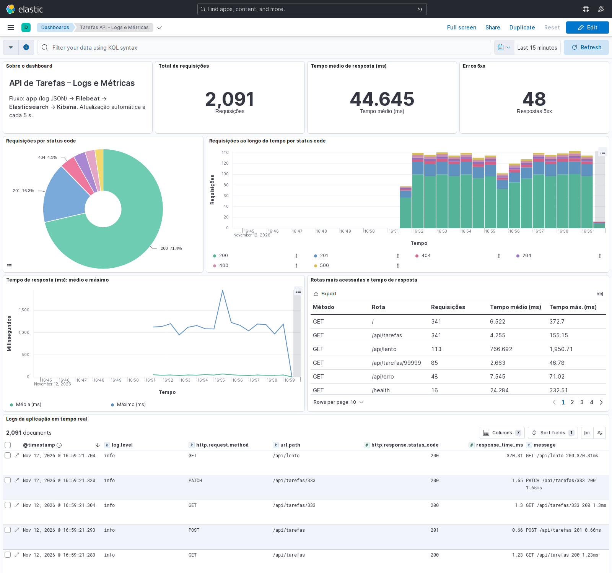

# Entrega da Aula 5 – Logs e APM com Elastic Stack

**DevOps Tools** · UNAMA · Prof. Rodrigo Silva Marques · Integrantes: ver [README](../README.md#integrantes)

## Arquivos entregues

- Configuração do Filebeat: [`monitoring/filebeat/filebeat.yml`](../monitoring/filebeat/filebeat.yml)
- Print do Kibana: [`prints/etapa4-dashboard-kibana.png`](prints/etapa4-dashboard-kibana.png); extra de APM em [`prints/aula5-apm-kibana.png`](prints/aula5-apm-kibana.png)

## Relatório

A aplicação Node.js grava cada requisição como uma linha JSON no padrão ECS em `/var/log/app/app.log`. Os campos incluem método, rota, status code e tempo de resposta.

O **Filebeat** lê esse arquivo com o input `filestream`, que funciona como um `tail -f` e guarda a posição lida para não perder nem duplicar eventos. Ele decodifica cada linha com o parser `ndjson` e envia os eventos em lotes ao **Elasticsearch**, no data stream `filebeat-8.17.0`.

No **Kibana** foi criado o data view `filebeat-*` e o dashboard "Tarefas API – Logs e Métricas". Ele mostra os logs em tempo real (atualização a cada 5 s), a distribuição de status code, a evolução das requisições ao longo do tempo, o tempo de resposta médio e máximo e os erros 5xx.

Um gerador de tráfego produz respostas 2xx, 4xx, 5xx e lentas, e com isso os gráficos mostram claramente a rota `/api/lento` (~770 ms) e os erros simulados.

Como passo extra, o agente **elastic-apm-node** envia as transações a um **APM Server**. No Kibana (Observability → APM) aparecem a latência, o *throughput* e os erros com *stack trace* de cada rota.

O ambiente sobe inteiro com `docker compose up -d --build` em `monitoring/`, e o dashboard é importado com `./kibana/importar-dashboard.sh`.
