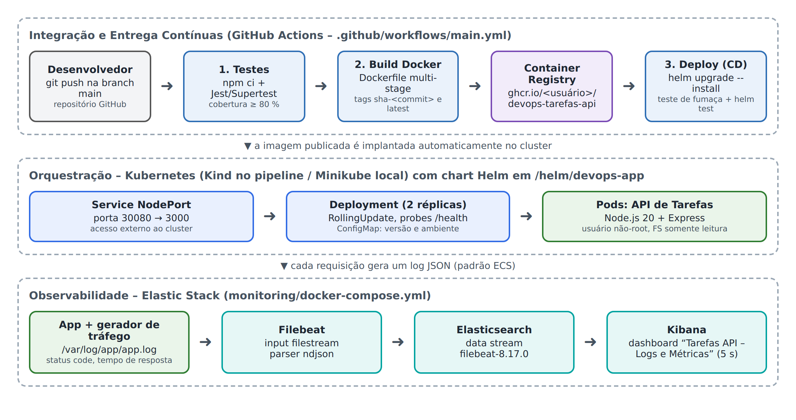
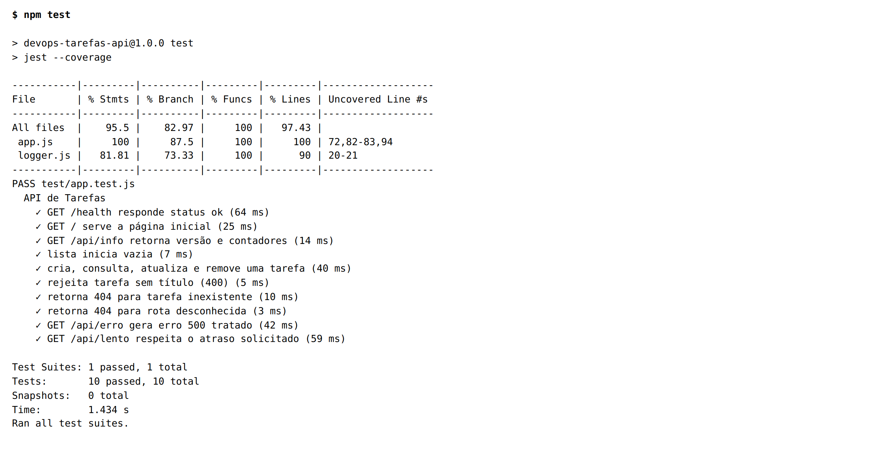
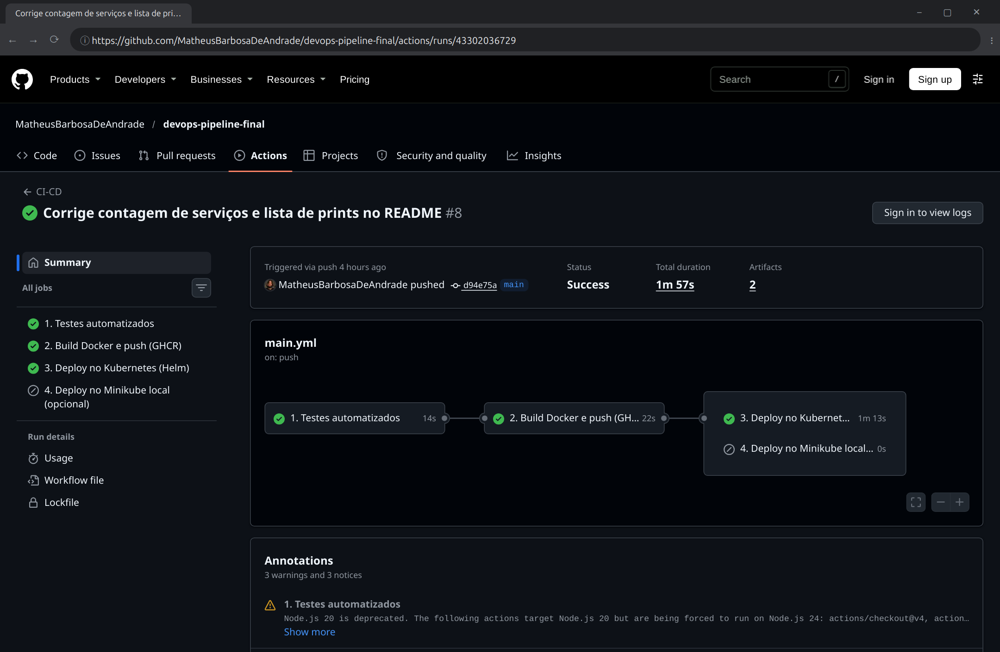
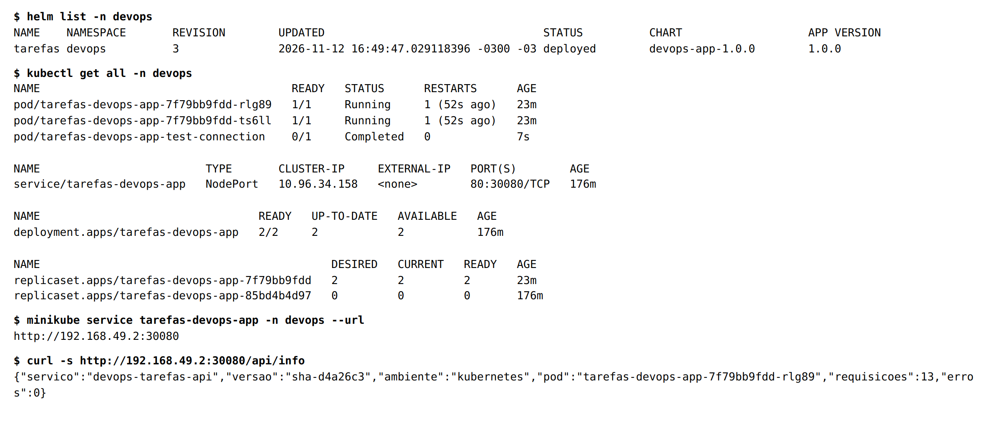
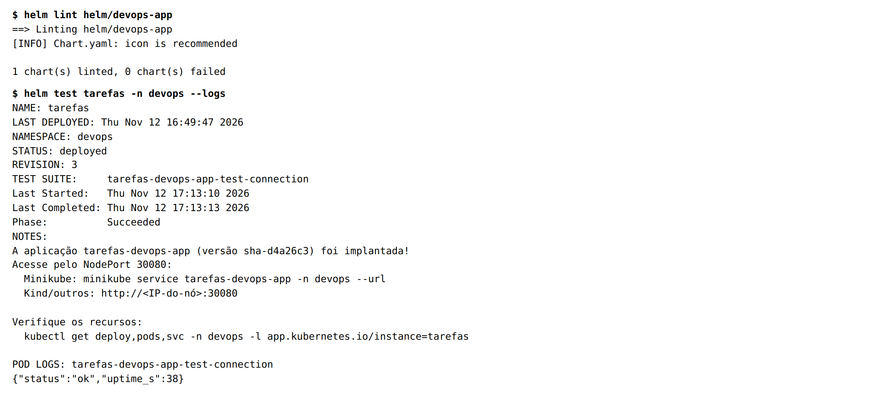
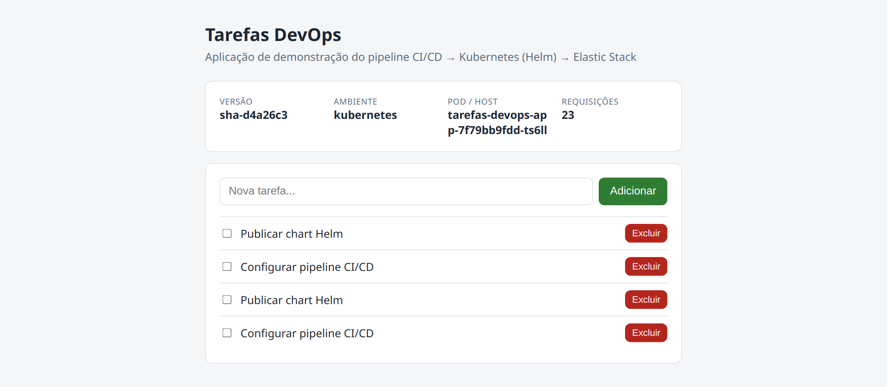
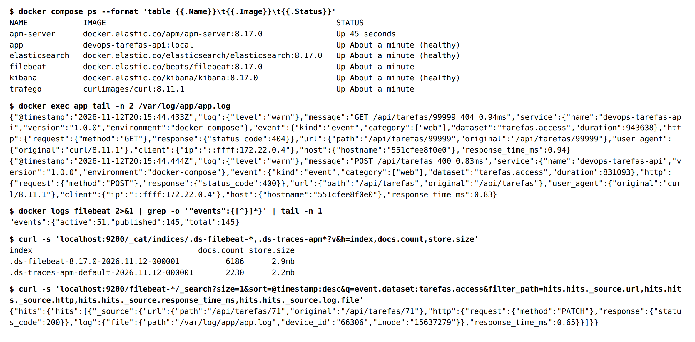
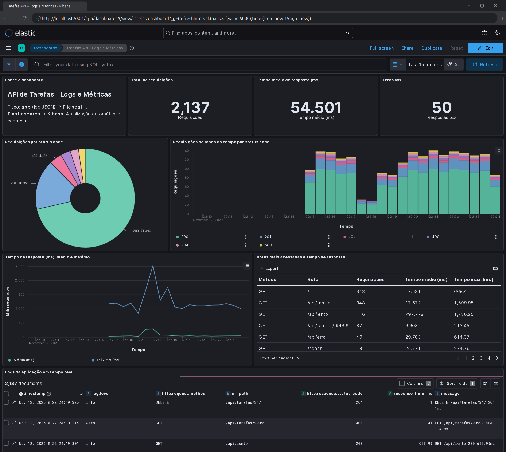
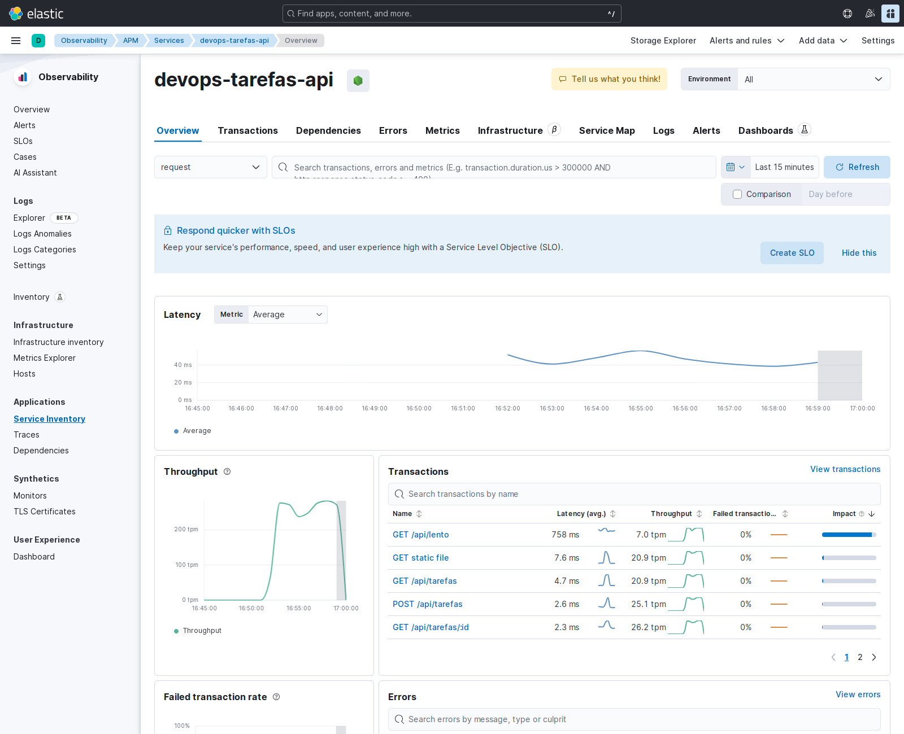

# Etapa 5 – Relatório final

**Atividade Avaliativa – DevOps na Prática** · DevOps Tools · UNAMA – Universidade da Amazônia
Prof. Rodrigo Silva Marques · Integrantes: ver [README](../README.md#integrantes)
Repositório: https://github.com/MatheusBarbosaDeAndrade/devops-pipeline-final

Este relatório consolida o projeto. Ele traz o passo a passo da implementação das Etapas 2, 3 e 4, os desafios enfrentados, uma reflexão crítica sobre o valor do DevOps e o roteiro da apresentação. Os conceitos da Etapa 1 estão em [`relatorio-etapa1.md`](relatorio-etapa1.md).

## Sumário

1. [Arquitetura](#1-arquitetura)
2. [Passo a passo da implementação](#2-passo-a-passo-da-implementação)
3. [Desafios enfrentados](#3-desafios-enfrentados)
4. [Reflexão crítica: como DevOps agrega valor](#4-reflexão-crítica-como-devops-agrega-valor-ao-ciclo-de-vida-do-software)
5. [Roteiro da apresentação (10 min)](#5-roteiro-da-apresentação-10-minutos)

---

## 1. Arquitetura



Uma API de tarefas em Node.js passa por um ciclo DevOps completo:

1. `git push` dispara o **GitHub Actions**.
2. Os testes rodam (Jest).
3. A imagem Docker é construída e publicada no **GitHub Container Registry (GHCR)**.
4. O **Helm** implanta a nova versão num cluster **Kubernetes**, exposta via **NodePort 30080**.
5. Em execução, a aplicação grava logs JSON que o **Filebeat** envia ao **Elasticsearch**, e o **Kibana** exibe em um dashboard. O agente **APM** envia as transações ao APM Server.

| Ferramenta | Versão | Papel |
|---|---|---|
| Node.js / Express | 20 / 4.21.2 | API de tarefas |
| Jest / Supertest | 29.7.0 / 7.1.4 | Testes automatizados e cobertura |
| Docker | 29 | Containers |
| GitHub Actions + GHCR | – | Pipeline CI/CD e registry de imagens |
| Kubernetes (Kind / Minikube) | 1.37 | Cluster no pipeline / cluster local |
| Helm | 3 | Empacotamento e deploy |
| Elasticsearch / Kibana / Filebeat / APM Server | 8.17.0 | Logs, métricas e APM |

---

## 2. Passo a passo da implementação

### 2.1 Aplicação e testes (base da Etapa 2)

**Passo 1 – API.** Em `app/` há uma API REST em Express com estas rotas:

- `GET /`: interface web;
- `GET /health`: usada pelas *probes* do Kubernetes;
- `GET /api/info`: versão, ambiente, pod e contadores;
- CRUD completo em `/api/tarefas`;
- duas rotas de demonstração: `/api/lento`, que responde em 300 ms a 1,2 s, e `/api/erro`, que gera um erro 500.

**Passo 2 – Logs estruturados.** Um middleware grava cada requisição como uma linha JSON com campos do Elastic Common Schema: `@timestamp`, `log.level`, `http.request.method`, `url.path`, `http.response.status_code` e `event.duration`, além do campo próprio `response_time_ms`. Respostas 4xx viram `warn` e 5xx viram `error`. Os logs vão para o stdout e, se a variável `LOG_FILE` estiver definida, também para um arquivo, que é o que o Filebeat lê.

**Passo 3 – Testes.** São 10 testes com Jest + Supertest. Eles cobrem health check, CRUD, validação (400), recurso inexistente (404), erro (500) e a rota lenta. Se a cobertura de linhas ficar abaixo de 80%, o `npm test` falha, e o pipeline falha junto. A cobertura obtida foi de **97,4%**.



**Passo 4 – Dockerfile.** O build tem duas etapas (*multi-stage*). A primeira instala só as dependências de produção (`npm ci --omit=dev`). A segunda gera uma imagem `node:20-alpine` que roda com o usuário sem privilégios `node`, expõe a porta 3000 e tem `HEALTHCHECK` em `/health`. A imagem final tem cerca de 227 MB.

### 2.2 Pipeline de CI (Etapa 2)

**Passo 5 – Workflow.** O arquivo [`.github/workflows/main.yml`](../.github/workflows/main.yml) roda em todo push ou pull request na `main` e também manualmente. Os jobs são encadeados com `needs`, então um só começa se o anterior passou:

| Job | O que faz |
|---|---|
| **1. Testes automatizados** | Checkout, Node 20 com cache, `npm ci`, `npm test`; publica a cobertura como artefato |
| **2. Build Docker e push (GHCR)** | Login no GHCR com o `GITHUB_TOKEN` automático (nenhum segredo cadastrado), tags `sha-<commit>` e `latest`, build com cache e push. Em PRs, só constrói |
| **3. Deploy no Kubernetes (Helm)** | Ver a Etapa 3 abaixo |
| **4. Deploy no Minikube (opcional)** | Mesmo chart num Minikube real, por um runner *self-hosted*; ativado pela variável `DEPLOY_MINIKUBE=true` |

**Passo 6 – Execução.** O primeiro push executou o pipeline inteiro com sucesso em **2 min 26 s**: testes em 18 s, build/push em 39 s e deploy em 1 min 18 s. A imagem ficou publicada em `ghcr.io/matheusbarbosadeandrade/devops-tarefas-api`.



### 2.3 Continuous Deployment com Kubernetes e Helm (Etapa 3)

**Passo 7 – Chart Helm.** O chart fica em [`helm/devops-app/`](../helm/devops-app/):

- `values.yaml`: 2 réplicas, imagem do GHCR, Service **NodePort 30080**, limites de CPU e memória, `securityContext` não-root com sistema de arquivos somente leitura;
- `deployment.yaml`: `RollingUpdate` com `maxUnavailable: 0`, para atualizar sem queda; *readiness* e *liveness probes* em `/health`; e um checksum do ConfigMap que força o rollout quando a configuração muda;
- `service.yaml`: NodePort, porta 80 → 3000 do container → 30080 no nó;
- `configmap.yaml`: inclui `APP_VERSION` igual à tag da imagem, o que mostra qual versão está no ar;
- `hpa.yaml` e `ingress.yaml`: opcionais, desligados por padrão;
- `tests/test-connection.yaml`: o `helm test`, que chama `/health` pelo Service.

**Passo 8 – Deploy automático (CD).** O job 3 roda depois do push da imagem e segue esta sequência:

1. cria um cluster **Kind** dentro do runner, com a porta 30080 mapeada;
2. cria o namespace `devops` e o segredo `ghcr-cred`;
3. valida o chart com `helm lint`;
4. roda `helm upgrade --install --wait --atomic` com a nova tag;
5. confere o rollout;
6. faz o **teste de fumaça** pelo NodePort, verificando se `/api/info` devolve exatamente a tag recém-publicada;
7. roda `helm test`.

Nenhuma etapa exige aprovação humana: é **Continuous Deployment**. Se a nova versão não ficar saudável, o `--atomic` faz o rollback sozinho.

**Passo 9 – Serviço rodando no Kubernetes.** O cluster Kind do pipeline é apagado no fim do job, então a validação persistente foi feita no **Minikube** local, com a **mesma imagem que o pipeline publicou no GHCR** (`sha-d4a26c3`):

```bash
minikube start
helm upgrade --install tarefas helm/devops-app -n devops --create-namespace --set image.tag=sha-d4a26c3
kubectl get all -n devops
minikube service tarefas-devops-app -n devops --url
```



O print mostra o Deployment com **2/2 réplicas**, o Service **NodePort 80:30080** e a resposta de `/api/info` com a versão `sha-d4a26c3`. A seguir, a validação com `helm lint` e `helm test`, e depois a página da aplicação carregada pelo NodePort (`http://192.168.49.2:30080`):





### 2.4 Logging e métricas com Elastic Stack (Etapa 4)

**Passo 10 – Stack em containers.** O [`monitoring/docker-compose.yml`](../monitoring/docker-compose.yml) sobe os serviços abaixo. Healthchecks garantem a ordem de subida: Kibana, Filebeat e APM Server só iniciam depois que o Elasticsearch fica saudável.

- **Elasticsearch 8.17**: *single-node*, heap de 512 MB, segurança desligada por ser ambiente acadêmico;
- **Kibana 8.17**;
- **a aplicação**, com `LOG_FILE=/var/log/app/app.log`;
- **Filebeat 8.17**;
- **APM Server 8.17**;
- **um gerador de tráfego** com respostas 200, 201, 204, 400, 404 e 500, além de respostas lentas.

**Passo 11 – Como os Beats coletaram os dados.** O fluxo é o da aula: *Filebeat lê os logs → envia ao Elasticsearch → Kibana exibe*. A configuração está em [`monitoring/filebeat/filebeat.yml`](../monitoring/filebeat/filebeat.yml). Em detalhe:

1. **Geração.** A cada requisição, a API grava uma linha JSON em `/var/log/app/app.log`. Esse arquivo fica num volume Docker (`app-logs`) compartilhado com o container do Filebeat em modo somente leitura.
2. **Leitura (input `filestream`).** O Filebeat vigia `/var/log/app/*.log`. Para cada arquivo, abre um *harvester* que acompanha as linhas novas, como um `tail -f`. A posição lida (*offset*) fica no *registry*, persistido no volume `filebeat-data`. Se o Filebeat reiniciar, ele continua de onde parou, sem perder nem duplicar eventos.
3. **Decodificação (parser `ndjson`, `target: ""`).** Cada linha vira um documento estruturado. Por isso `http.response.status_code` e `response_time_ms` são campos numéricos pesquisáveis, e não texto solto. O Filebeat ainda acrescenta `log.file.path`, `host.*`, `agent.*` e o campo `origem`.
4. **Envio (`output.elasticsearch`).** Os eventos vão em lotes (*bulk*) para o data stream `filebeat-8.17.0`. Na primeira conexão, o Filebeat instala o *index template* com os tipos ECS, e `setup.template.append_fields` declara `response_time_ms` como `float`. Se o Elasticsearch estiver fora do ar, o Filebeat tenta de novo com *backoff*, garantindo entrega ao menos uma vez.
5. **Visualização.** O Kibana consulta o data view `filebeat-*` usando `@timestamp` como campo de tempo.

O print abaixo mostra cada parte desse fluxo: os containers em execução, linhas JSON geradas pela aplicação, o contador de eventos publicados pelo Filebeat, os índices com os documentos (logs e traces do APM) e um documento já indexado com `log.file.path` e `response_time_ms`.



**Passo 12 – Dashboard.** O dashboard foi definido como código. O script [`gerar_dashboard.py`](../monitoring/kibana/gerar_dashboard.py) gera o arquivo `.ndjson`, e o [`importar-dashboard.sh`](../monitoring/kibana/importar-dashboard.sh) o importa pela API do Kibana. Ele fica versionado no Git e é recriado com um comando. O dashboard **"Tarefas API – Logs e Métricas"** tem:

- **logs em tempo real**: tabela com hora, nível, método, rota, status e tempo, com atualização a cada 5 s e janela dos últimos 15 min;
- **status code**: rosca com a distribuição e barras empilhadas por status ao longo do tempo;
- **tempo de resposta**: indicador de tempo médio, linhas de médio e máximo, e tabela de rotas. Ela mostra que `/api/lento` responde em ~770 ms, enquanto as outras rotas ficam em poucos ms;
- **indicadores**: total de requisições e quantidade de erros 5xx.



### 2.5 Extras (criatividade)

- **Elastic APM** (passo extra da Aula 5). O agente `elastic-apm-node` está na aplicação e o `apm-server` sobe no Compose. Cada requisição vira uma *transaction*, com latência, *throughput*, taxa de falhas e erros com *stack trace*, visíveis em Observability → APM:

  

- **Interface web**, que mostra a versão implantada e o pod que respondeu.
- **Teste de fumaça** que confere a versão no ar, `helm test`, e **rollback automático** com `--atomic`.
- **Dashboard como código** e **gerador de tráfego**.
- **Job summary** no Actions e job opcional de deploy no Minikube por runner *self-hosted*.
- **Segurança**: container não-root, sistema de arquivos somente leitura, *capabilities* removidas e login no registry sem senha fixa.

---

## 3. Desafios enfrentados

| Desafio | Causa | Solução |
|---|---|---|
| `helm test` falhou com *bad address* logo após iniciar o Minikube | O CoreDNS ainda não estava pronto, então o nome do Service não resolvia | Esperar o CoreDNS ficar *Ready* antes dos testes |
| `helm test --logs` não mostrava a saída | A política `hook-succeeded` apagava o pod antes da leitura dos logs | Manter só `before-hook-creation` |
| A lista de tarefas "mudava" ao atualizar a página | Com 2 réplicas, cada pod guarda os dados em memória e o Service alterna entre eles | Documentado como limitação; em produção, usar um banco externo (app *stateless*) |
| Risco de `response_time_ms` ser mapeado como inteiro | O mapeamento dinâmico usa o tipo do primeiro valor recebido | Declarar `float` em `setup.template.append_fields` |
| GHCR recusou o nome da imagem | O registry exige minúsculas, e o usuário do GitHub tem maiúsculas | Converter com `${GITHUB_REPOSITORY_OWNER,,}` |
| O cluster não conseguia baixar a imagem | Pacotes novos no GHCR nascem privados | Segredo `ghcr-cred` + `imagePullSecrets`; depois o pacote foi tornado público |
| Pouca memória (8 GB) para tudo ao mesmo tempo | Minikube + Elastic Stack + APM disputam a RAM | Heap do Elasticsearch em 512 MB e Minikube e Elastic Stack em momentos diferentes |
| O cluster do pipeline não persiste | O Kind é criado dentro do runner e destruído no fim | Validar no próprio job (fumaça + `helm test`) e repetir a validação no Minikube com a imagem do GHCR |
| `kubectl` 1.35 × servidor 1.37 | Diferença de versões (*version skew*) | Usar `minikube kubectl --` quando necessário |

Dois desafios ensinaram mais:

- **A lista de tarefas com 2 réplicas.** Ao atualizar a página, ora apareciam umas tarefas, ora outras. O episódio mostra na prática que aplicações que escalam horizontalmente precisam ser *stateless*.
- **A falha intermitente do `helm test`.** Ela veio de uma condição de corrida no DNS e mostra por que pipelines precisam esperar as dependências ficarem saudáveis. É por isso que o workflow usa `--wait`, `rollout status` e tentativas repetidas no teste de fumaça.

---

## 4. Reflexão crítica: como DevOps agrega valor ao ciclo de vida do software

Mesmo em escala pequena, o projeto mostra o ganho em cada fase do ciclo de vida:

- **Desenvolvimento.** Os testes que rodam a cada push funcionam como rede de segurança. O erro aparece em minutos e fica ligado ao commit que o causou, quando ainda é barato corrigir (*shift-left*).
- **Build e entrega.** A imagem imutável, com a tag do SHA do commit, garante que o artefato testado é exatamente o mesmo que vai para o cluster.
- **Implantação.** Com *rolling update* e rollback automático, o deploy deixa de ser um evento tenso e manual e vira uma operação rotineira e reversível.
- **Operação.** Logs estruturados, dashboard e APM mostram o que acontece em produção. A rota lenta e os erros 500 aparecem na hora, o que fecha o ciclo de feedback.

A pesquisa DORA (FORSGREN; HUMBLE; KIM, 2018) liga essas práticas a melhores resultados em quatro métricas: frequência de deploy, tempo de espera para mudanças, tempo de restauração e taxa de falhas. Aqui, o tempo entre o commit e a nova versão no cluster caiu para cerca de 2 minutos e meio, e o `--atomic` reduz o estrago de uma mudança defeituosa.

Mas é preciso olhar com senso crítico:

- **Ferramenta não é cultura.** Sem colaboração, responsabilidade compartilhada e aprendizado sem culpados, o pipeline só automatiza um processo ruim mais rápido (KIM et al., 2018).
- **Automação tem custo.** Kubernetes, Helm e Elastic Stack exigem conhecimento e recursos. Só a Elastic Stack ocupou a maior parte da RAM disponível. Para sistemas pequenos, uma solução mais simples pode ser mais adequada.
- **Continuous Deployment depende de bons testes.** Os 97% de cobertura medem quais linhas foram executadas, não se todos os cenários foram verificados.
- **Simplificações acadêmicas.** A segurança do Elasticsearch desligada e o cluster efêmero precisariam ser revistos em produção, com autenticação, TLS, gestão de segredos, varredura de vulnerabilidades da imagem (DevSecOps) e um ambiente de homologação.

**Conclusão.** O DevOps agrega valor ao tornar **curto e confiável** o caminho entre a ideia e o usuário, e ao devolver ao time **informação real** sobre o software em execução. O valor não está numa ferramenta isolada. Está na integração de práticas que tornam as entregas pequenas, frequentes, observáveis e reversíveis.

**Trabalhos futuros:**

- persistir as tarefas num banco de dados;
- criar um ambiente de homologação com aprovação manual, juntando Delivery e Deployment;
- incluir varredura de vulnerabilidades no pipeline;
- coletar os logs direto do cluster com o Filebeat em DaemonSet.

---

## 5. Roteiro da apresentação (10 minutos)

| Tempo | Conteúdo | O que mostrar |
|---|---|---|
| 0:00–1:00 | Abertura: objetivo e arquitetura | Diagrama de arquitetura (seção 1) |
| 1:00–2:30 | Conceitos (Etapa 1): DevOps × ágil, CI × Delivery × Deployment, VM × container | Tabelas e analogias do [relatório da Etapa 1](relatorio-etapa1.md) |
| 2:30–5:00 | **Demo do pipeline**: alterar algo (ex.: o texto em `app/public/index.html`), `git push`, acompanhar os jobs no Actions | Aba Actions; summary do deploy com a nova tag |
| 5:00–6:30 | Kubernetes/Helm: `kubectl get all -n devops`, app no navegador, `helm test` | Minikube ligado antes da apresentação |
| 6:30–8:30 | **Demo do monitoramento**: `docker compose start`, abrir o dashboard, chamar `/api/erro` e `/api/lento` e ver os gráficos reagirem; APM | Kibana em `localhost:5601` |
| 8:30–9:30 | Desafios e reflexão crítica | Seções 3 e 4 |
| 9:30–10:00 | Encerramento e perguntas | – |

**Dica:** com 8 GB de RAM, não deixe o Minikube e o Elastic Stack ligados juntos. Faça a parte de Kubernetes e rode `minikube stop` antes de `docker compose start`.

---

## Referências

BECK, Kent et al. **Manifesto para desenvolvimento ágil de software**. 2001. Disponível em: https://agilemanifesto.org/iso/ptbr/manifesto.html. Acesso em: 12 nov. 2026.

BURNS, Brendan; BEDA, Joe; HIGHTOWER, Kelsey. **Kubernetes**: up and running. 2. ed. Sebastopol: O'Reilly, 2019.

ELASTIC. **Filebeat reference [8.17]**. 2026. Disponível em: https://www.elastic.co/guide/en/beats/filebeat/8.17/index.html. Acesso em: 12 nov. 2026.

ELASTIC. **APM Node.js agent reference**. 2026. Disponível em: https://www.elastic.co/guide/en/apm/agent/nodejs/current/index.html. Acesso em: 12 nov. 2026.

FORSGREN, Nicole; HUMBLE, Jez; KIM, Gene. **Accelerate**: the science of lean software and DevOps. Portland: IT Revolution, 2018.

GITHUB. **GitHub Actions documentation**. 2026. Disponível em: https://docs.github.com/actions. Acesso em: 12 nov. 2026.

HELM. **Helm documentation**. 2026. Disponível em: https://helm.sh/docs/. Acesso em: 12 nov. 2026.

KIM, Gene et al. **Manual de DevOps**. Rio de Janeiro: Alta Books, 2018.

MARQUES, Rodrigo Silva. **Logs e Application Performance Monitoring (APM) com Elastic Stack**: aula 5. Belém: UNAMA, 2026. Material didático da disciplina DevOps Tools.
